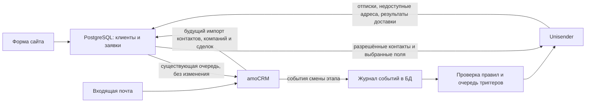

# Клиенты, компании, amoCRM и Unisender

Дата решения: 30 октября 2026. **Проектирование, не работающая интеграция.**
Владелец выбрал сначала согласовать логику и очистить тесты. Новый runtime,
таблицы синхронизации, API-ключ Unisender, списки и сценарии пока не включать.
Существующую передачу сайт → amoCRM оставить без изменений: контакт, сделка,
поля заявки и примечание продолжают работать прежним образом.

## 1. Границы и проверенное исходное состояние

Сейчас `crm.archive_cursor()` сохраняет клиента и заявку в транзакции приёма
формы. Дедупликация `customers` использует один `contact_key`: email без учёта
регистра либо телефон без нецифровых знаков. Отдельные email и телефон есть в
`orders`, но не в реестре идентификаторов клиента. Поэтому обращения одного
человека сначала по телефону, потом по email могут стать разными карточками.

В `customers` нет компании, amoCRM ID или атрибуции. Компании в заявках — текст
`orders.business_company`. UTM и ClientID находятся в `orders` и неизменяемом
снимке `lead_submissions.payload`. Текущий `amo_loop.py` читает новые сделки для
уведомлений, но не синхронизирует справочники и историю этапов.

30.10 прочитана структура рабочей БД: девять таблиц; до очистки — 31 клиент и
39 заявок. Наличие таблиц и колонок проверено на сервере, поведение будущего
обмена не проверено. Точные результаты очистки — в
[отчёте](verification/20261030-customer-sync-design.json).

## 2. Потоки и ответственность за данные

БД — общий реестр клиентов со стабильными собственными ID и историей источников.
amoCRM — источник актуальных менеджерских изменений, компаний, связей и сделок.
Unisender — источник статуса подписки/отписки, жалоб и доставляемости email.
Сайт — источник фактически отправленных данных формы и её аналитического снимка.

Обратный импорт **не** создаёт заявку сайта, не вызывает `archive_cursor()` с
выдуманным UUID формы, не создаёт SMTP/LOOP-задания и не отправляет сделку обратно
в amoCRM. Импорт клиента не означает согласие на рассылку. Исходная передача
сайта в CRM сохраняется; новая нормализация идентичности применяется в локальной
БД без изменения полей и поведения исходящей интеграции.

Владение полями задаётся явно. Исторические снимки заявок не изменяются. Новая
форма сохраняет собственные значения в заявке, но не перезаписывает подтверждённую
менеджером компанию или имя карточки. CRM-пустота не очищает локальное значение;
намеренное удаление/отвязка — отдельное подтверждённое изменение с источником.
Конфликтующие одинаково свежие значения отправляются на разбор.

## 3. Предлагаемая модель БД

Названия ниже — спецификация будущей миграции, не установленные таблицы.

| Сущность | Ключевые поля и назначение |
| --- | --- |
| `customers` | Существующий `id`; имя; nullable `company_id`; первое известное касание и его источник; `is_test`; состояние объединения/архива. Legacy `contact/contact_key` сохраняются для совместимости до отдельной миграции. |
| `customer_identifiers` | `id`, `customer_id`, `kind` (email/phone), исходное и нормализованное значение, источник, признак основного/общего адреса, период актуальности. Несколько email/телефонов одного человека. |
| `companies` | Собственный `id`, название, ИНН и КПП при наличии, источник, время обновления, архивный статус. amoCRM ID хранится в таблице соответствий. |
| `customer_company_history` | Клиент, компания, период связи, источник. `customers.company_id` показывает основную текущую связь; история сохраняет смену работодателя. |
| `external_entity_links` | `provider`, `account_id`, `entity_type`, `external_id`, локальный ID; уникальность внешней сущности в аккаунте. Несколько CRM-дублей могут ссылаться на одного локального клиента. |
| `customer_touchpoints` | Время события и время получения, канал, набор UTM, страница обращения, ClientID, источник записи/ID события, достоверность. Снимок, а не догадка об источнике. |
| `crm_deals` | Собственный ID и amo ID, воронка, этап, название, компания, бюджет/валюта при необходимости, CRM-время изменения; nullable связь с существующей заявкой сайта. |
| `crm_deal_contacts` | Сделка ↔ клиенты, основной контакт. Связь многие-ко-многим; один клиент может иметь несколько сделок. |
| `crm_events` | Уникальный ID события amoCRM, сущность, событие, старый/новый этап, время в источнике и время получения; baseline/import/live и результат обработки. |
| `marketing_permissions` | Адрес/клиент, канал и назначение сообщений, статус `unknown/allowed/withdrawn`, доказательство и дата; отдельно блокировки Unisender. |
| `integration_outbox` | Назначение, объект/событие, версия, ключ дедупликации, статус, попытки, следующая попытка, аренда, безопасный код ошибки и удалённый ID. |
| `sync_cursors` | Поток и аккаунт, граница успешно сохранённого диапазона, состояние пагинации/начальной загрузки. |
| `sync_conflicts` / `sync_exclusions` | Неоднозначные совпадения, причины блокировки, удалённые тестовые ID/идентификаторы и решение оператора. |

Одна компания может иметь много клиентов. Клиент без известной компании получает
NULL, не фиктивную компанию «Неизвестно». Компания сделки хранится отдельно: она
не обязана совпадать с текущим работодателем контакта. Если реально понадобятся
несколько одновременных компаний одного человека, активные связи расширяются в
таблице истории, а `company_id` остаётся основной связью.

Общий адрес вроде отдела закупок не гарантирует одного человека. В БД допускается
отмеченная общая точка контакта и конфликт владения; нельзя глобальным UNIQUE на
email заставлять разные человеческие карточки сливаться. Однозначные личные
идентификаторы защищаются частичными ограничениями и транзакционной блокировкой.
В Unisender email является единицей получателя: один адрес не получает копию
письма на каждого локального человека; персонализация общего адреса нейтральная.

## 4. Как сопоставлять клиентов и компании

Порядок для контакта из amoCRM:

1. Найти соответствие `(amoCRM, account_id, contact_id)`. Оно устойчивее имени,
   телефона и email; удалённые/слитые CRM ID сохраняются как алиасы.
2. Если соответствия нет — собрать **все** email/телефоны, нормализовать и найти
   совпадения в локальном реестре. Email: пробелы по краям и регистр; не удалять
   `+suffix`/точки. Телефон: международный формат с явным правилом страны;
   неоднозначные короткие номера не превращать в российские автоматически.
3. Если идентификаторы однозначно принадлежат одному клиенту, связать с ним CRM ID.
   Несколько возможных клиентов, email одного и телефон другого, общий телефон
   компании — конфликт, без автоматического слияния/рассылки.
4. Если совпадений нет и есть пригодный идентификатор — создать карточку и ссылки.
   Контакт без email/телефона можно сохранить по amo ID с неполным профилем;
   он не участвует в email-выгрузке. Имя не является ключом дедупликации.
5. Сохранить изменения и outbox в одной транзакции. Параллельная заявка сайта
   использует ту же локальную процедуру сопоставления/блокировки. До включения
   импорта старые `contact_key` и email/телефоны из заявок индексируются этой
   процедурой; неоднозначности остаются на разборе, а не «чинятся» массово.

Если email пришёл без телефона и его раньше не было, связь с телефонной карточкой
может быть неизвестна. Нельзя обещать отсутствие таких дублей до появления
общего идентификатора или ручного подтверждения.

Компании сначала сопоставляются по amo company ID. Другая CRM-карточка с тем же
проверенным ИНН может быть тем же юрлицом; для филиалов учитывается КПП и отдельно
согласуется уровень учёта. Если ИНН отсутствует, одинаковые названия/домены —
только кандидаты на разбор. Компания из текста формы не превращается автоматически
в одноимённое юрлицо. ИНН не выводится из имени или домена почты.

Импортировать сначала компании, затем контакты и их связи, затем сделки/связи.
Почтовый контакт, созданный amoCRM, проходит тот же путь. Если источник письма
создал пока только сделку/неразобранное без контакта, карточка человека не
выдумывается из заголовка: фиксируется неполная связь и повторная сверка.

## 5. Первые касания и аналитика

Хранить в карточке `first_touch_at`, `first_touch_channel`, `first_touch_source`,
`first_touch_source_id`, `first_touch_quality`, `first_utm_source/medium/campaign/
content/term`, `first_source_path`, `first_ym_client_id`. Детали и последующие
касания — в `customer_touchpoints`; поле карточки является указателем/проекцией
самого раннего известного подтверждённого события.

**Исторически доступно первое известное обращение, не первый визит.** Текущий
браузер сохраняет последний встретившийся набор UTM внутри вкладки. Ссылка с
новыми UTM заменяет его целиком; `source_path` — страница формы. Нет надёжной
истории первого визита, начальной посадочной и referrer. ClientID — идентификатор
браузера, не доказательство личности. По нему клиентов автоматически не объединять.

После очистки можно заполнить первые касания из самой ранней нетестовой заявки
каждого клиента, упорядочив `(created_at, id)`. Набор копируется целиком из одного
события. Нельзя взять раннюю дату, UTM из позднего заказа и выдать их за одно касание.
Существующие `orders` и fingerprint/payload не переписывать; поздние обращения
сохраняются отдельно. Без UTM источник неизвестен, не «прямой» и не «органика».

Для клиента из почты канал `email`, механизм получения `amoCRM`; рекламный
источник, UTM и ClientID — NULL, если не существуют отдельные подтверждённые
данные. `created_at` CRM-контакта — дата карточки, не обязательно дата первого
письма: выбирать проверенное событие обращения, иначе указывать качество
`crm_record_created`, не объявляя его рекламным касанием.

Более раннее событие, найденное при исторической загрузке, может уточнить первое
касание **с журналом изменения и происхождением**. Позднее обращение не заменяет
раннее. Уточнения одного события дополняют его, не склеивают разные кампании.
Слияние клиентов выбирает наиболее раннее доказанное касание и сохраняет обе истории.

Настоящий first-visit tracking — отдельный будущий этап с правилами срока хранения,
согласия и работы между вкладками/устройствами. В этой задаче форму/аналитику сайта
не менять. Источник компании не выводить автоматически из случайного сотрудника:
у юрлица может быть несколько контактов и каналов.

## 6. Надёжность обратной синхронизации

Начальная загрузка работает в режиме baseline: переносит сведения, **не запускает
письма по старым сделкам**. До неё загрузить закрытый список исключённых тестовых
сущностей и разрешить конфликты идентификаторов. Затем включать инкрементальный
опрос контактов/компаний/сделок по `updated_at`, например раз в 1–5 минут, с
перекрытием окна, пагинацией, проверкой прав и контролем лимитов API.

Курсор продвигается только после надёжной записи всего обработанного диапазона.
Повтор окна идемпотентен; старый ответ не затирает более свежую версию. Не обрезать
пагинацию молча: текущий общий клиент имеет предел десяти страниц, при будущей
массовой загрузке нужны сохраняемые страницы/разбиение диапазонов.

Для изменений этапов читать журнал событий, а не только текущее состояние сделки:
между двумя опросами этап может измениться несколько раз. Периодическая полная
сверка дополняет события; удаления/слияния обрабатываются как архив/алиас, без
каскадного удаления заявок и без обратного восстановления удалённой карточки.
Отсутствие объекта в одной странице/ошибка 403 не доказывают удаление.

Webhook впоследствии может ускорять синхронизацию, но входной пакет — сигнал для
повторного чтения через авторизованный API, а не доверенная команда на отправку
письма. Проверить поддерживаемую аутентификацию; не предполагать наличие подписи.

Контроль: давность курсора, возраст очереди, повторы, неразрешённые конфликты,
лимит 500 контактов Unisender, 401/403/429, несовпадение полей, неизвестный результат
POST. Токен amoCRM по действующему регламенту требует обновления до 23.10.2027.
Нужен регламент восстановления после длительного простоя и наблюдение за очередью;
существующий SMTP-монитор её не покрывает.

## 7. Выгрузка в Unisender

Источник — представление над `customers` + идентификаторами + компаниями +
разрешениями, а не прямой `SELECT * FROM customers`. Только нетестовые, неархивные,
однозначно сопоставленные адреса. Отсутствующий email не заменять фиктивным;
телефонные контакты остаются в БД до появления адреса.

Предлагаемый минимум полей: собственный `CUSTOMER_ID`, имя, email, телефон при
необходимости, `COMPANY_ID/COMPANY_NAME`, канал первого обращения, доступные UTM
первого обращения, направление интереса с явно определённым правилом. Передавать
только согласованную проекцию; полный текст заявки, файлы, историю переписки и
секреты туда не копировать. ClientID нужен для локальной аналитики; по умолчанию
не выгружать его в рассыльщик.

Начать с одного управляемого списка и сегментов по полям. Раздельные списки —
для разных подписок/назначений, а не по списку на каждый этап сделки. Существующие
списки/ручные поля не затирать. Перенос всех записей не означает подписку всех на
маркетинг: базовый статус разрешения — `unknown`. Согласие на обработку заявки
не превращать автоматически в разрешение на рекламные рассылки. Это правило
модели данных; юридическую формулировку будущего согласия согласовать отдельно.

Отписка, жалоба и блокировка имеют приоритет над CRM-обновлением. Хранить состояние
по адресу и назначению; смена email требует новой проверки, а не переноса согласия
со старого адреса автоматически. Повторный импорт не должен восстановить подписку.
До начальной выгрузки проверить активные сценарии существующих списков: добавление
контакта может само запустить письмо. Первый перенос — в изолированный список без
включённых сценариев и без писем подтверждения до отдельного согласования.

API бесплатен отдельно от конструктора интеграций; ограничения основного тарифа
и рассылок сохраняются. `importContacts` поддерживает обновление контактов и
пользовательских полей (до 500 записей за запрос, до 50 пользовательских полей).
Его ответ и фактическое состояние импортированных строк нужно проверить;
HTTP 200 сам по себе не означает успешную обработку каждой строки.

## 8. Этапы сделок и будущие письма

Не хранить единственный «этап клиента» как источник триггеров. Источник события —
конкретная сделка, воронка, переход и время. amoCRM предоставляет
`lead_status_changed` со старым/новым этапом и ID воронки.

Предлагаемая цепочка:

1. Прочитать событие → сохранить `crm_events` с уникальным внешним ID.
2. Обновить зеркало сделки; определить контакты и адрес получателя (по умолчанию
   основной контакт сделки, не все сотрудники компании).
3. Применить правило `(pipeline_id, status_id, rule_version)` и условия: разрешение
   на нужный тип письма, не тест, наличие email, отсутствие конфликтов/блокировок.
4. Создать outbox с ключом `(event_id, rule_id, rule_version, recipient_id)` и
   запланированным временем. Исторический baseline исключён из запуска.
5. Непосредственно перед отправкой снова проверить актуальный этап, разрешение,
   закрытие сделки и частотный лимит. Устаревшее напоминание отменить с причиной.
6. Запустить согласованный сценарий Unisender через его API-триггер и сохранить
   результат. Поддержку сценария, лимиты и повторный запуск в текущем аккаунте
   проверить отдельно; сейчас сценарии не созданы и не проверены.

Например: «КП отправлено» → запланировать напоминание через согласованный срок →
если к сроку уже «Предоплата получена», отменить. Возврат сделки на тот же этап
является новым событием, но право повторной отправки задаётся правилом: один раз
за сделку либо за новый вход, с ограничением частоты по адресу. Два заказа одного
клиента — два контекста; общий email не должен получать противоречащие сообщения.

У Unisender есть API-триггер с отдельным URL сценария и JSON-параметрами. Передавать
контекст заказа, event ID и ключ повторов, если конкретный сценарий это поддержит.
Не использовать глобальное поле контакта «последняя сделка» как единственный
источник персонализации параллельных писем: оно может измениться до отправки.
Сначала проверить, что сценарий удерживает контекст конкретного запуска.

Локальная уникальность outbox не гарантирует единственную внешнюю отправку.
Если POST принят, но ответ потерян, состояние `uncertain`: сначала сверить запуск
у провайдера; без подтверждённой идемпотентности не повторять вслепую. Отличать
`queued`, `accepted_by_provider`, `delivered`, `bounced` и чтение; принятие API
не доказывает попадание во входящие, открытие не доказывает прочтение человеком.

## 9. Очистка тестов и защита от их возврата

Разовая очистка использует проверенный allowlist заявок, а не регулярное удаление
по словам `test/тест`. №11 содержит ровно «Тест», остальные имеют синтетические
метки и тестовые описания. Перед удалением сохраняется приватный dump и список
исключений с ID заявок/клиентов/UUID/известных тестовых сделок и контактными ключами.
Файлы резервирования не входят в Git/Obsidian и не передаются в Unisender.

[SQL очистки](../ops/maintenance/20261030-remove-confirmed-test-leads.sql) сначала
проверяется на восстановленной копии. В рабочей транзакции блокируются затрагиваемые
таблицы, проверяются 28 заявок/20 клиентов, отсутствие реальных заявок у этих
карточек и отправок `sending`. Зависимости удаляются раньше родителей, все
нецелевые строки сравниваются целиком до/после. Последовательности не сбрасываются.

В amoCRM ничего не удаляется. До будущего импорта обязательны список исключений,
проверка связанных тестовых контактов и `is_test` для новых QA-записей. Контакт,
имеющий реальные сделки, нельзя целиком исключить только из-за одного теста;
исключается тестовое событие. Исторический тестовый адрес владельца также не должен
навсегда блокировать его реальные обращения. Для старых тестовых CRM-сущностей,
созданных вне сайта, потребуется отдельная инвентаризация при первом импорте.

Восстановление: использовать резервную копию для выборочного возврата удалённых
тестовых строк в порядке родителей/детей; полный restore поверх работающей БД
недопустим, потому что уничтожит новые реальные заявки. Удалённые задания нельзя
восстановить как pending без отдельного решения — это повторит уведомления.

## 10. Этапы реализации и критерии готовности

1. Зафиксировать правила полей/компаний/идентификаторов, выбрать списки и назначение
   сообщений; проверить API-права и поля аккаунтов только чтением.
2. Добавить совместимые таблицы/ссылки, реестр идентификаторов и тестовые исключения;
   выполнить dry-run исторического сопоставления, отдельно разобрать конфликты.
3. Заполнить первые известные касания, не переписывая заявки. Проверить каждый
   перенос по исходному событию; неизвестные источники оставить неизвестными.
4. Включить только amoCRM → БД, затем проверить повторный опрос, новые письма,
   обновление контакта/компании, смену компании, общий email, параллельную форму,
   отсутствие циклов/дублей, восстановление курсора и отсутствие новых уведомлений.
5. Подключить Unisender сначала к изолированному тестовому списку, без рассылок.
   Проверить создание/обновление полей, существующие подписки, отписку, отказ API,
   исчерпание тарифа, смену email и неизвестный результат запроса.
6. Отдельно согласовать шаблоны, задержки и бизнес-правила писем. Проверить переходы
   этапов, возвраты, несколько сделок, отмену отложенных задач и потерю ответа.
7. Выпустить через штатный backend installer с проверенным коммитом в GitHub,
   backup/current/previous и мониторингом; заново проверить работающий приём формы.
   Публикация схемы в документе не равна установке миграции или запуску доставки.

На этом этапе **не решено**: какие контакты разрешены для маркетинга, какие поля
нужны в Unisender, какой список выбрать, правила юридических лиц/филиалов,
разрешение конфликтов старых дублей, назначение/частота будущих писем. Это не мешает
согласовать устройство системы и безопасно очистить явно синтетические записи.

## Официальные источники, проверены 30.10.2026

- [Unisender: доступ к API](https://www.unisender.com/ru/support/api/common/bulk-email/).
- [Тарифы конструктора и исключение собственных API-интеграций](https://www.unisender.com/ru/support/pricing-and-payment/tarifikaciya-integracij/).
- [Импорт контактов и дополнительных полей](https://www.unisender.com/ru/support/api/contacts/importcontacts/).
- [Параметры subscribe и режимы перезаписи](https://www.unisender.com/ru/support/api/contacts/subscribe/).
- [Обратные уведомления Unisender](https://www.unisender.com/ru/support/api/common/sistema-uvedomlenij-o-sobytiyah-webhooks/).
- [API-триггер сценария](https://www.unisender.com/ru/support/omnikanalnost/kak-ispolzovat-api-trigger/).
- [amoCRM: события и смена этапов](https://www.amocrm.ru/developers/content/crm_platform/events-and-notes).
- [amoCRM: сделки](https://www.amocrm.ru/developers/content/crm_platform/leads-api).
