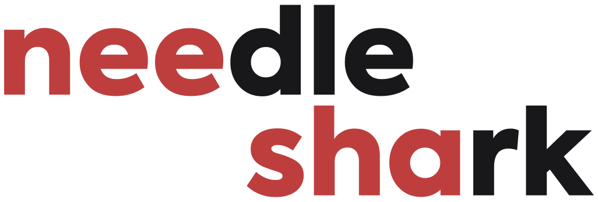
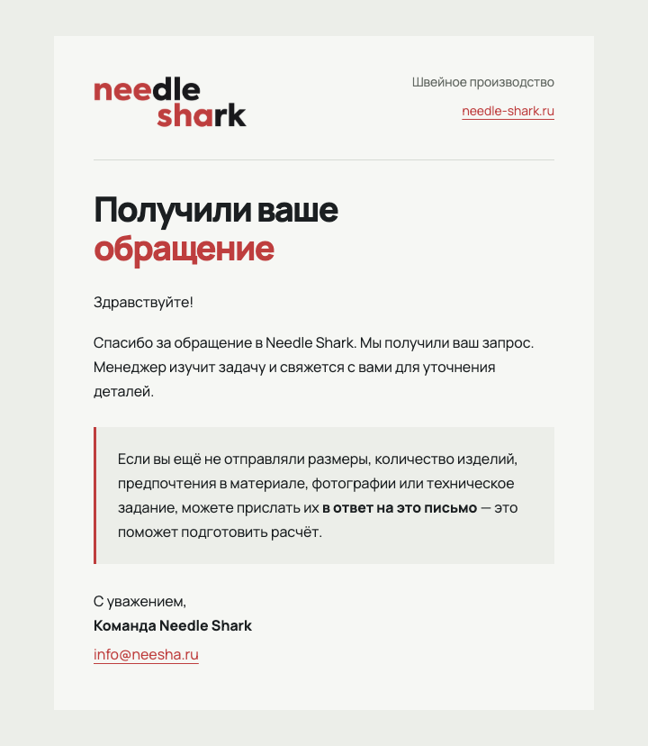
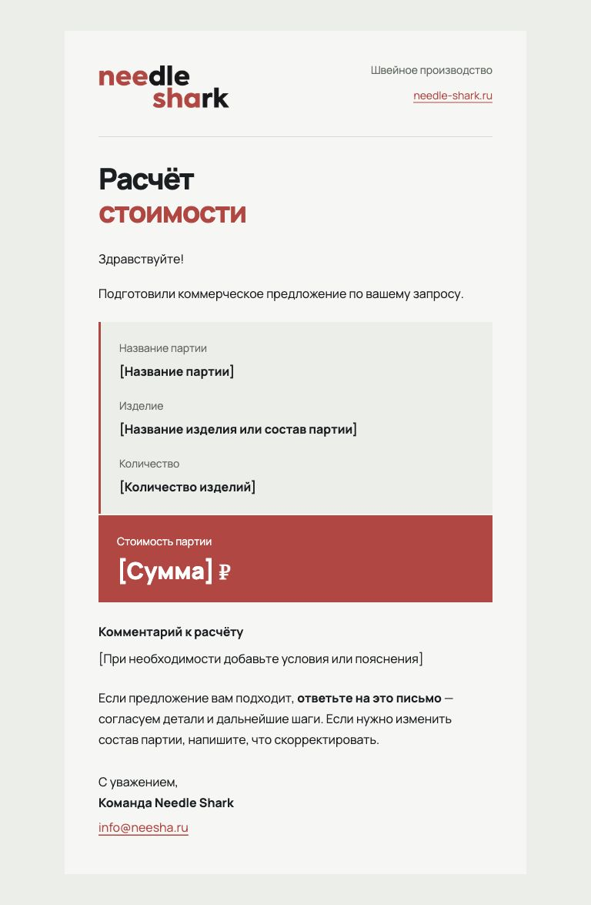

# Needle Shark - визуальный стиль и база знаний для агента

Версия 1.0 · 19 октября 2026

## Визуальный стиль Needle Shark

Самостоятельное руководство для дизайнера и визуального агента

Needle Shark - швейное производство. Визуальный язык бренда строится на точности, спокойной подаче и внимании к изделию: светлый фон, чёрные изделия, крупные заголовки и дозированный красный акцент.

> Основные опоры: исходный логотип · Manrope · #BE3E3E · свободное пространство · прямые углы.

### Как передать новому специалисту

Передайте весь ZIP-комплект. Этот PDF подходит для знакомства и визуальной сверки. BRAND_KNOWLEDGE.md содержит те же правила в текстовом виде для базы знаний агента. AGENT_INSTRUCTIONS.txt - короткая инструкция для его настройки. Логотип, шрифты и примеры находятся внутри комплекта.

Для обычной работы достаточно загрузить базу знаний и приложить исходные ресурсы. Настройка инструкций и базы знаний не равна дообучению модели на датасете. Если позднее понадобится именно дообучение, отдельно соберите согласованные пары «задание - результат».

Версия 1.0 · 19 октября 2026. Правила действующей айдентики собраны без изменения сайта. Примеры компоновки и задания агенту показывают способ применения; они не утверждают новые характеристики товаров или коммерческие условия.

## Основа бренда и приоритет правил

Профессионально, чисто, технически, спокойно

| Элемент | Правило |
| --- | --- |
| Название | Needle Shark. Два слова; сохранять написание. |
| Подпись | Швейное производство. |
| Сайт | https://needle-shark.ru/ |
| Почта | info@neesha.ru. Отличие домена от сайта намеренное. |
| Основной шрифт | Manrope. Запасной - Arial, sans-serif. |
| Фирменный акцент | #BE3E3E. Не заменять близким оттенком. |

### Что сохраняем в каждом материале

- Исходный логотип и его пропорции. Логотип не набирают заново и не поручают генератору перерисовать.
- Сдержанную палитру, читаемую иерархию, свободное пространство и чёткую сетку.
- Фокус на изделии, материале или конкретной задаче клиента. Декор не должен спорить с предметом.
- Деловой тон, обращение на «вы», конкретный следующий шаг без давления.

### Как разрешать расхождения

Прямое актуальное решение владельца имеет приоритет. Для новых материалов используйте действующее бренд-руководство и эту сводку. При конфликте с отдельным старым примером сохраняйте текущие правила и уточняйте только спорное изменение.

> В ранней концепции Industrial Minimalism / Clean Performance встречались Montserrat, Inter, IBM Plex Sans, другая светлая палитра и радиусы 16-24 px. Эти варианты не являются текущими настройками: здесь закреплены Manrope, палитра из раздела «Цветовая палитра» и преимущественно прямые углы.

## Логотип и его применение

Используйте готовый знак из комплекта

| Параметр | Значение |
| --- | --- |
| Мастер | assets/logo.svg - исходная векторная графика. |
| Пропорции | 1026 × 348; отношение ширины к высоте около 2,948:1. |
| Цвета знака | #BE3E3E и #18181B. Тёмный цвет логотипа сохраняется отдельно от цвета основного текста. |
| На текущем сайте | Ширина 152 px, высота пропорциональна. |
| В согласованном письме | Показ 171 × 58 px. PNG 513 × 174 px, тройное разрешение. |

### Правила размещения

- Сохранять взаимное расположение элементов, цвет и пропорции. Масштабировать равномерно.
- Оставлять свободное пространство вокруг знака. Универсальный минимальный отступ и минимальный размер не закреплены: проверять читаемость для конкретного носителя.
- Размещать на спокойной светлой поверхности. На тёмной композиции предусмотреть светлую область под исходный знак; новую инверсию согласовать отдельно.
- Не добавлять тени, обводки, наклон, объём, свечение или растяжение. Не использовать пёструю фотографию непосредственно под знаком.

> assets/logo-email.png имеет непрозрачную подложку #F6F7F4. Это экспорт для светлого письма. Для другого фона используйте SVG и экспортируйте заново; не принимайте цветную подложку за прозрачность.

В письме свободное место обеспечивают поля контейнера 44 px и интервал 32 px до разделителя. Это параметры конкретного носителя, а не универсальная охранная зона.

## Цветовая палитра

Светлая основа и точечный красный акцент

| Цвет | HEX | Назначение |
| --- | --- | --- |
| Акцент | #BE3E3E | Ссылки, выделение и основные действия |
| Основной текст | #1B1F21 | Заголовки, абзацы и тёмные поверхности |
| Бумага | #F6F7F4 | Основной светлый фон |
| Поверхность | #ECEEE9 | Подложки и смысловые блоки |
| Вторичный текст | #636963 | Подписи и пояснения |
| Разделитель | #D7DAD4 | Тонкие линии |
| Белый | #FFFFFF | Светлые элементы и текст на контрастном фоне |

### Как распределять цвет

Основные абзацы остаются тёмными. Красным выделяют действие, короткий смысловой фрагмент или линию. Увеличение площади красного допустимо по роли блока: в согласованном КП сумма показана белым на красном. Это не повод заливать красным весь макет.

- Не передавать смысл только цветом: ссылку также подчёркивать, важный фрагмент выделять насыщенностью.
- Проверять читаемость фактической пары текста и фона. Основной красный не использовать для мелкого текста на тёмной поверхности.
- Не добавлять золотые, синие или зелёные акценты по собственной инициативе. Новая палитра требует решения владельца.

HEX-значения - цифровые цвета RGB. В этой базе нет утверждённых CMYK/Pantone. Для печати нужна отдельная цветопроба; автоматическую конвертацию нельзя считать фирменным печатным стандартом.

## Типографика и иерархия

Одно семейство с разной насыщенностью

Пример иерархии: «Швейное производство» крупным Manrope 800; пояснение обычным Manrope 400. Образец набора: АБВГД абвгд 0123456789.

| Роль | Текущая настройка |
| --- | --- |
| Основной текст сайта | Manrope 16 px, 400; межстрочный интервал 1,65. |
| Крупные заголовки | Manrope 800; плотный набор; размер зависит от блока. |
| Основной H1 B2B | clamp(2.5rem, 4.35vw, 4.35rem); line-height 1.1; tracking -0.06em. Есть адаптивные переопределения. |
| H2 B2B | clamp(2rem, 3.5vw, 3.5rem); line-height 1.15; tracking -0.05em. |
| Выделение | 700. Подписи и пояснения обычно 12-14 px. |
| Текст письма | 16 px / 27 px, 400. Заголовок 38/43 px; на узком экране 30/35 и 28/33 px. |

### Правила переноса на новый носитель

- Сохранять отношение крупного заголовка к спокойному основному тексту. Размеры веб-страницы не переносить механически в баннер или печать.
- Не обрезать длинный текст ради одинаковой высоты и не уменьшать его до нечитаемого размера. Менять переносы, сетку и распределение пространства.
- Проверять кириллицу, цифры, знак рубля, адрес почты и длинные названия.
- В письмах оставлять текст текстом. Manrope поддерживается не во всех почтовых клиентах, поэтому проверять и Arial.

В комплекте два исходных WOFF2: кириллица и латиница, а также лицензия SIL OFL. Это веб-шрифты. Для программы, требующей TTF/OTF, получите совместимую версию Manrope по той же лицензии; не переименовывайте расширение файла.

## Композиция и компоненты

Один главный фокус и общая сетка

Схема компоновки: заголовок и пояснение расположены рядом с изображением предмета; действие следует после пояснения. Это схема порядка элементов, а не готовый рекламный макет.

Схема показывает порядок элементов, а не утверждённый шаблон рекламы. Содержание и пропорции выбирают под задачу и формат.

- Выстраивать маршрут взгляда: главный предмет или заголовок, пояснение, подтверждённая деталь, действие.
- Использовать свободное пространство, преимущественно прямые углы и тонкие разделители. Не добавлять декоративные градиенты, большие скруглённые карточки и случайные цвета.
- Выравнивать соседние карточки по общим рядам: изображение, характеристики, заголовок, описание, действие. Резервировать место под изображения и изменяющееся состояние.
- Сохранять полезную часть кадра и пропорции изображений. Не исправлять сетку растяжением фотографии или обрезанием текста.

| Компонент сайта | Текущий ориентир |
| --- | --- |
| Основная кнопка | #BE3E3E, белый текст, прямые углы; минимальная высота 52 px, в шапке 48 px. |
| Вторичная кнопка | Прозрачный фон, тёмный текст и тонкая граница. |
| Карточка | Общая сетка, сдержанная граница, содержание определяет высоту. |
| Ссылка и поле | Понятное действие, видимый фокус, читаемый ввод и сообщение об ошибке. |

На новом носителе выбирать отступы по масштабу и плотности содержания. Числа для безопасных зон сторис, баннеров и маркетплейсов зависят от площадки: проверять требования перед экспортом, а не считать старые пиксельные значения универсальными.

## Фотографии и генерация изображений

Изделие должно оставаться узнаваемым и достоверным

### Визуальная подача

- Изделия преимущественно чёрные, фон минималистичный. На чёрной ткани должны читаться форма, швы и фактура; предмет не должен сливаться с фоном.
- При наличии фотографии конкретного изделия сохранять конструкцию, количество деталей, крепления и пропорции. Не добавлять карманы, ремни, маркировку или фурнитуру как декоративное улучшение.
- Выбирать ракурс по задаче: общий вид для формы, крупный план для реально существующей детали, схема для подтверждённых размеров.
- Согласовывать предметы и фон по свету и перспективе. Не маскировать дефекты изображения чрезмерным контрастом, туманом или декоративным свечением.

### Правила для визуального агента

- В задании указывать, что создаётся: предметная иллюстрация, обработка фотографии, композиционный макет или схема.
- Генерацию и ретушь хранить с понятной пометкой происхождения. Сгенерированный цех не выдавать за документальное фото действующего производства.
- Фирменный логотип накладывать исходным ресурсом при сборке макета. Точный текст также добавлять на этапе вёрстки, если генератор не обеспечивает его правильность.
- Если изображение должно показывать реальный заказ или конкретную модель, запросить достоверные исходники. Произвольный похожий предмет не заменяет референс.

> Водоотталкивание, влагонепроницаемость, UV-защита, прочность, плотность ткани, совместимость с моделью, гарантия и срок производства - факты, а не элементы стиля. Показывать или писать их только при наличии подтверждения для конкретного изделия.

Бейджи «Хит», «В наличии», рейтинги, отзывы и цифры продаж тоже требуют подтверждения. Ранние рекламные примеры с подобными фразами не служат источником товарных данных.

## Применение в письмах и других материалах

Согласованные письма как визуальный ориентир

Слева - подтверждение обращения, справа - коммерческое предложение. Это согласованные шаблоны. Поля в квадратных скобках в КП заполняются перед отправкой; они не являются данными заказа.

Общие элементы писем: контейнер до 600 px, фон письма #F6F7F4, внешний фон #ECEEE9, поля 44 px на широком и 24/22 px на узком экране. В шапке логотип, подпись «Швейное производство» и сайт; до 500 px подпись переходит под знак. Подсказка использует светлую подложку и красную линию 3 px.

| Носитель | Как применять систему |
| --- | --- |
| Письмо | Живой текст, спокойная иерархия, понятный ответ или действие. Проверить Arial, мобильный вид и почтовые клиенты. |
| Документ или КП | Логотип, крупный заголовок, разделители, ясная таблица. Цены, сроки и условия только из задания. |
| Реклама или карточка | Один главный предмет и короткое сообщение. Только подтверждённые свойства и соответствующее им изображение. |
| Серия публикаций | Повторять сетку, типографику и положение основных элементов; менять содержание по смыслу. |

Снимки подтверждают визуальную композицию. Они не доказывают одинаковое отображение во всех почтовых программах. Полноразмерные оригиналы включены в комплект.

## Инструкция для визуального агента

Готовый текст для поля инструкций

Ты создаёшь визуальные материалы для Needle Shark, швейного производства. Используй приложенную базу знаний BRAND_KNOWLEDGE.md версии 1.0 от 19 октября 2026 и исходные ресурсы комплекта. Актуальное прямое указание владельца имеет приоритет; спорные изменения айдентики уточняй.

Сохраняй название Needle Shark, исходный логотип, основной шрифт Manrope и запасной Arial. Палитра: акцент #BE3E3E, текст #1B1F21, фон #F6F7F4, поверхность #ECEEE9, вторичный текст #636963, линии #D7DAD4, белый #FFFFFF. Цвет тёмной части логотипа #18181B не менять.

Стиль: строгая сетка, свободное пространство, крупные плотные заголовки, преимущественно прямые углы, тонкие разделители, дозированный красный. Изделия преимущественно чёрные, фон минималистичный. Не добавляй декоративные градиенты, большие скруглённые карточки, случайные шрифты и цвета.

Логотип используй готовым файлом, без перерисовки, изменения пропорций, теней и эффектов. Изображение конкретного изделия должно сохранять его конструкцию. Генерацию обозначай как иллюстрацию или визуализацию; не выдавай её за фото реального заказа или производства.

Не придумывай характеристики, совместимость, цены, сроки, гарантии, отзывы, рейтинги и статус наличия. Для непроверенного свойства попроси подтверждение или исключи его из макета. Соблюдай согласованный текст; пиши спокойно, конкретно, на «вы».

Перед работой выясни цель, аудиторию, носитель, размер, текст, исходные изображения, подтверждённые факты и ожидаемое действие. Если части данных нет, обозначь, что требуется; в концептуальном макете используй только явно помеченные поля, удаляемые перед публикацией.

Проверяй читаемость в конечном размере, сетку, длинный текст, целостность изображений, правильность логотипа и соответствие действия подписи. Для веб-макетов проверяй 360, 390, 768, 1024 и 1440 px, фокус и контраст ввода.

Отдавай результат с кратким объяснением композиции, перечнем использованных исходников, выполненными проверками и оставшимися вопросами. Подготовка макета сама по себе не означает публикацию. Сайт needle-shark.ru; почта info@neesha.ru.

Этот же текст доступен отдельным файлом AGENT_INSTRUCTIONS.txt. Сначала прикрепите базу знаний, затем вставьте инструкцию. Если агент не читает SVG или WOFF2, передавайте эти файлы человеку, который собирает итоговый макет.

## Бриф и порядок работы

Достаточно данных для конкретного визуального решения

| Что задать | Что должно быть в ответе |
| --- | --- |
| Задача и аудитория | Для кого материал и что человек должен понять или сделать. |
| Носитель и размер | Площадка, размеры, ориентация, конечный масштаб и ограничения размещения. |
| Предмет и исходники | Какое изделие, какие фото или схемы обязательны, что нельзя менять. |
| Текст и факты | Точный заголовок, пояснение, подтверждённые свойства, источник цифр. |
| Действие | Что произойдёт после CTA и куда ведёт ссылка, если она нужна. |
| Результат | Формат экспорта, необходимость редактируемого исходника и варианты размеров. |

### Пример задания

> Подготовь концепцию квадратного изображения 1080 × 1080 для Needle Shark. Используй приложенную фотографию чёрного изделия без изменения конструкции и исходный логотип. Заголовок: «Швейное производство». Фон #F6F7F4, Manrope, один красный акцент #BE3E3E. Не добавляй свойства, цены, сроки или отзывы. Покажи композицию и объясни порядок чтения. Это пример брифа, не готовое объявление.

### Последовательность

- Сверить бриф с базой знаний; отделить подтверждённые факты от пожеланий.
- Выбрать один главный фокус и сетку, определить место заголовка, предмета и действия.
- Собрать макет из исходных ресурсов. При необходимости сначала создать иллюстрацию, затем наложить точный текст и логотип.
- Проверить конечный размер и варианты размещения, длинный текст, кадрирование и читаемость.
- Передать превью и исходник. Явно обозначить, что нужно согласовать перед использованием.

После согласования сохраняйте удачные примеры вместе с исходным заданием и кратким объяснением решения. Так база пополняется конкретными образцами; отклонённые варианты храните отдельно с причиной отклонения.

## Проверка и сопровождение базы

Готовый материал должен быть узнаваемым и пригодным к использованию

- Название, почта и адрес сайта написаны правильно. Исходный логотип читается и не искажён.
- Использованы Manrope и нужные цвета. Размеры и насыщенность образуют понятную иерархию.
- У макета один главный фокус, достаточно свободного места и согласованная сетка.
- Изображение сохраняет конструкцию предмета; текст и важные детали не обрезаны.
- Каждая характеристика, цифра, цена и обещание подтверждены. Нет вымышленных отзывов и рейтингов.
- CTA описывает реальное действие. В финальном файле нет незаполненных полей и служебных подписей.
- Проверены целевой размер, переносы, длинные данные и требования площадки. Для веба - пять ширин и интерактивные состояния.
- Экспорт открывается, шрифты и изображения доступны. При необходимости приложен редактируемый исходник.

### Состав переносимого комплекта

| Файл или папка | Назначение |
| --- | --- |
| Needle-Shark-Brand-Guide.pdf | Самостоятельное руководство с палитрой, схемой и примерами. |
| BRAND_KNOWLEDGE.md | Полный текст правил для базы знаний; переходы к другим документам не нужны. |
| AGENT_INSTRUCTIONS.txt | Инструкция для настройки агента. |
| assets/ | Исходный SVG, PNG для письма и два визуальных примера. |
| fonts/ | Два WOFF2 Manrope и лицензия OFL. |
| START_HERE.txt | Короткий порядок передачи и подключения. |

### Как обновлять

Меняйте правила после решения владельца и повышайте версию комплекта. Одновременно обновляйте текстовую базу, PDF и инструкцию. Убирайте из активной базы прежние конфликтующие версии, сохраняя их отдельно как историю. Не считайте отдельный новый макет автоматическим изменением всей системы.

Основа версии 1.0: действующее руководство по бренду от 19 октября 2026, текущие общие цвета и B2B-типографика, согласованные письма. Ранняя концепция использована только для сверки расхождений. Все необходимые правила изложены здесь; внутренние документы, рабочая история, клиентские данные и доступы в комплект не входят.
